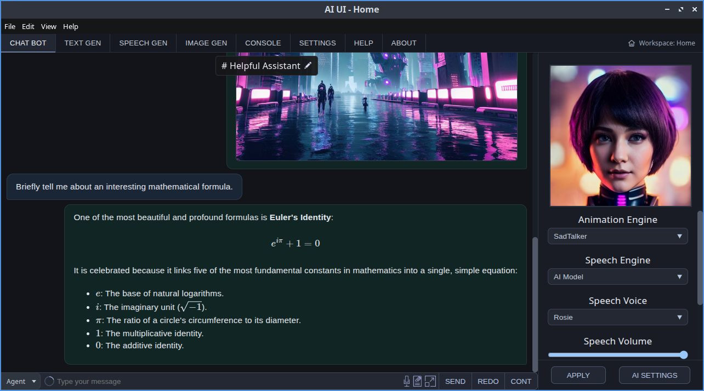

# AI UI

A user-friendly interface for interacting with AI. Includes a voiced chat bot feature with an animated and customizable avatar. Built with Electron.



## Install Guide

Download the [latest release](https://github.com/JacobBruce/AI-UI/releases) of AI UI, extract it, then follow the steps below.

You always need a **Python environment** for the AI engine. The Electron app itself is included in the release.

### Quick Install (recommended)

Run the Python script from the extracted release folder (requires Python 3.12 - 3.14):

```
python install.py
```

On Linux you may need `python3 install.py`. The script creates the venv, installs the lite or full stack, and CUDA/CPU PyTorch (for full stack). When finished it writes/updates the config file at `~/.aiui/config.json`.

Non-interactive examples:

```
python install.py --venv ~/aiui-venv --lite --yes
python install.py --venv C:/aiui-venv --full --torch cu128 --yes
python install.py --upgrade --venv ~/aiui-venv --full --torch skip --yes
```

### Manual Install

<details><summary>Show install instructions for Windows</summary><br>

#### 1. Python

Install [Python](https://www.python.org/downloads/windows/) (3.12.x recommended).

CUDA is optional but recommended if you have an Nvidia GPU:

- [CUDA Toolkit](https://developer.nvidia.com/cuda-toolkit-archive) (12.8 recommended)

Open a command prompt and create a virtual environment:

```
python -m venv C:/venv
```

Replace `C:/venv` if you want the environment somewhere else. Activate it:

```
C:/venv/Scripts/activate.bat
```

If your GPU supports CUDA, install PyTorch **before** the other requirements (not needed if using lite requirements):

```
pip install torch torchvision torchaudio --index-url https://download.pytorch.org/whl/cu128
```

Then install the engine packages (replace `C:/AI_UI` with where you extracted the release; it should contain `AI_UI.exe`):

```
pip install -r C:/AI_UI/engine/requirements.txt
```

Use `requirements-lite.txt` instead of `requirements.txt` if you only want to use remote API's and don't need to run local models.

#### 2. App packages (only if needed)

Skip this if your release already includes `resources/app/app.bundle.js`, `vendor.bundle.js`, and `node_modules`.

Otherwise install [Node.js](https://nodejs.org) for Windows, then:

```
cd C:/AI_UI/resources/app
npm install
```

#### 3. Launch

Start AI UI by launching `AI_UI.exe`. On the **Settings** tab, set **Python Binary** to your venv interpreter, e.g. `C:/venv/Scripts/python.exe`.

</details>

<details><summary>Show install instructions for Linux</summary><br>

#### 1. Python

Ensure Python is installed (3.12.x recommended). On Debian/Ubuntu you may also need:

```
sudo apt install python3-pip python3.12-venv
```

Create and activate a virtual environment:

```
python3 -m venv ./venv
source ./venv/bin/activate
```

If your GPU supports CUDA, install PyTorch **before** the other requirements (not needed if using lite requirements):

```
pip install torch torchvision torchaudio --index-url https://download.pytorch.org/whl/cu128
```

Then install the engine packages (replace `./AI_UI` with the extracted release path; it should contain the `electron` binary):

```
pip install -r ./AI_UI/engine/requirements.txt
```

Use `requirements-lite.txt` instead of `requirements.txt` if you only want to use remote API's and don't need to run local models.

#### 2. App packages (only if needed)

Skip this if your release already includes `resources/app/app.bundle.js`, `vendor.bundle.js`, and `node_modules`.

Otherwise:

```
sudo apt install npm
cd AI_UI/resources/app
npm install
```

#### 3. Chromium sandbox and launch

From the folder that contains the `electron` binary (not from another working directory):

```
sudo chown root:root ./chrome-sandbox
sudo chmod 4755 ./chrome-sandbox
./electron
```

If you prefer not to configure the sandbox helper:

```
./electron --no-sandbox
```

On the **Settings** tab, set **Python Binary** to your venv interpreter, e.g. `path/to/venv/bin/python3`.

</details>

## Important Info

### Node packages and bundles

The UI loads two prebuilt files:

- `resources/app/vendor.bundle.js` — jQuery, markdown-it, highlight.js, KaTeX helpers, etc.
- `resources/app/app.bundle.js` — AI UI’s own renderer code

Those are produced with esbuild (`npm run build:vendor` / `npm run build:app`). The Electron **main** process also needs packages under `resources/app/node_modules` (for example `adm-zip` for downloads).

**For GitHub releases:** the built `*.bundle.js` files and the packages under `resources/app/node_modules` are included with releases so you do **not** need Node.js.

**If those files are missing** (or you cloned the git repo), install [Node.js](https://nodejs.org) and run:

```
cd path/to/AI_UI/resources/app
npm install
```

### Windows Users

If you place AI UI into Program Files or another protected directory, you may need to run as administrator. Prefer a normal folder such as `C:/AI_UI/`.

### Linux Users

Always start AI UI from the directory that contains the `electron` binary so relative paths resolve correctly.

The `chrome-sandbox` binary must be owned by root with mode `4755` for the Chromium sandbox, unless using `--no-sandbox`.

## Upgrading

1. Extract the new release over (or beside) your existing install.
2. Re-run the install script against your existing venv:

```
python install.py --upgrade --venv path/to/venv --lite --yes
# or full local stack (skip torch if already installed):
python install.py --upgrade --venv path/to/venv --full --torch skip --yes
```

Or activate your Python venv and update packages manually:

```
pip install -U -r path/to/AI_UI/engine/requirements-lite.txt
# or full local stack:
pip install -U -r path/to/AI_UI/engine/requirements.txt
```

3. If the release notes say Node dependencies changed, or `app.bundle.js` / `vendor.bundle.js` / `node_modules` are missing, run `npm install` again in `resources/app` (or `python install.py --npm --venv ...`).

## Getting Started

1. Launch AI UI and open the **Settings** tab.
2. Set **Engine Folder** to the included `engine` directory if it's not auto-detected (contains `aiui_engine.py`).
3. Confirm **Python Binary** points at your venv (`.../Scripts/python.exe` on Windows, `.../bin/python3` on Linux).
4. For **remote chat**: set **Use Remote Backend** to `True` and configure Remote Settings (see below).
5. For **local chat**: set **Text Model** (and optionally image/TTS/ASR models) to a local folder or Hugging Face model ID.
6. Click **APPLY**, then check the **Console** tab if the engine does not start.

Local chat needs a text model in Hugging Face Transformers format (full `requirements.txt` stack). Image features need a Diffusers-format image model.

The image/TTS/ASR and avatar animation models can still be used with remote chat mode but will also require the full `requirements.txt` stack.

## Remote Chat

The **Remote Settings** can point the Chat Bot at a remote API instead of loading a local text model. OpenAI-compatible endpoints use the OpenAI Python SDK; Anthropic Messages uses the Anthropic SDK.

1. Set **Use Remote Backend** to `True`.
2. Set **Remote Model ID** (required).
3. Leave **Remote Base URL** empty for Hugging Face Inference Providers (`https://router.huggingface.co/v1`; use your HF token), or set a URL such as:

```
https://openrouter.ai/api/v1
https://api.openai.com/v1
http://localhost:11434/v1
```

4. Optional: when Base URL is empty, set **Remote Provider** to pin a router provider (appended as `model:provider`).
5. Set **Remote API Key**, or leave it empty to fall back to **HuggingFace Access Token** (OpenAI-compat / HF only — Anthropic requires an API key). Local serve/Ollama can omit both keys.
6. Optional: set **Remote Protocol** to `OpenAI` (default; use for Hugging Face Inference Providers and OpenRouter) or `Anthropic` (Anthropic Messages).
7. For Anthropic: leave **Base URL** empty for `api.anthropic.com`, set **Model ID** (e.g. `claude-sonnet-4-6`), enable **Prompt Cache** (default) for automatic ephemeral caching.
8. Click **APPLY**. The engine will not load local chat weights while Remote is active.

File attachments: The attach dialog **Vision** control selects the local multimodal family and is disabled when Text Backend is Remote. Remote sends images (up to 10 MiB) and videos (up to 100 MiB) as `image_url` / `video_url` (http or base64) plus text-file contents; audio is skipped on remote.

## Context Compaction

In AI Settings, **Context Token Budget** enables context summarization (aka context compaction) when the conversation length approaches that limit.

Set **Context Token Budget** to `0` to use classic **Max Message Memory** pruning (old information is lost, prefer summarization for long-range tasks). 

To customize the context summarization instructions, place a `compact_prompt.txt` file in `~/.aiui`.

## Tool Use

With **Enable Tool Use** on, tool schemas are passed into the chat template via the `tools` argument (AI UI Template and Model Template).

The engine accepts JSON object, JSON array (multi-call), and XML `<function=...>` / `<parameter=...>` forms inside `<tool_call>`.

Use **AI UI Template (no tool prompt)** when a rule should teach the call format instead of the built-in template instructions.

## Model Files

This repository does not ship MakeItTalk, Wav2Lip, SadTalker, or IMTalker model weights. AI UI downloads them automatically when they are required.
